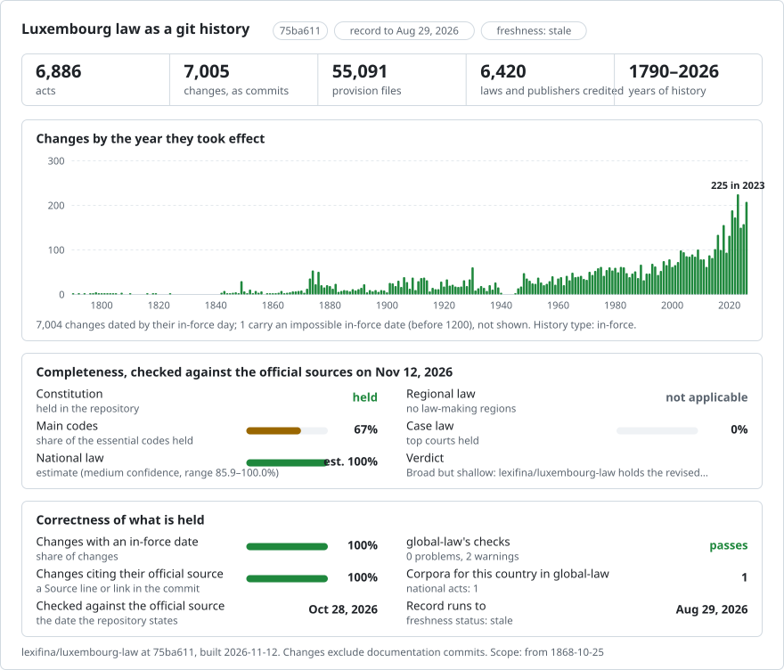

# Luxembourg law, change by change

[Français](README.md) · **English**

<picture>
<source media="(prefers-color-scheme: dark)" srcset="data/effort-dark.svg">

</picture>

Part of [lexifina/global-law](https://github.com/lexifina/global-law), one git history for every country's law: this is Luxembourg's national law, which global-law reads at `luxembourg/national/acts/`.

Two Luxembourg acts as a git repository: the **Constitution** (from the text of 1868, through 38 consolidated versions to 2026, including the revised Constitution in force on 1 July 2023) and the **Covid-19 law of 17 July 2020** (32 versions). Each amending law is one commit, credited to that law and dated the day its changes took effect, at noon in Luxembourg. The text is the French text published by [Legilux](https://legilux.public.lu), the official journal of the Grand Duchy.

## Now growing to every act Legilux publishes (from 13 November 2026)

The record is being extended, in pushes every few minutes, from the Constitution and the laws in force to every kind of
act in the Mémorial that Legilux's open data holds. **[`PLAN.md`](PLAN.md)** lists every part with its progress against
Legilux's own counts; [`TERMS.md`](TERMS.md) records the licences and how personal data is handled.

| Folder | What |
| --- | --- |
| `loi/`, `rgd/`, `agd/`, `argd/`, `a/`, `amin/`, `rmin/`, `rcsf/`, `rbcl/`, `conv/`, `acc/` ... | acts of the Mémorial A, one folder per act named by its ELI (`rgd/2020/03/18/a165/`) |
| `memorial-b/<kind>/` | acts of the Mémorial B (administrative publications), whose numbers can repeat the Mémorial A's |
| `local/<commune>/<kind>/` | communal regulations (`rc`) and temporary traffic regulations (`rtc`), by the commune the notice names |
| `data/actes/<kind>.csv` | every act handled: with its text on `main`, or with metadata and the official link only |
| `data/eu-transposition.csv` | which act transposes which EU directive (Legilux's transposition records) |
| `data/chambre/projets-et-propositions-de-loi.csv` | the bills filed at the Chambre des Députés since 1965 (not law) |
| `jurisprudence/<court>/<yyyy>/<mm>/` | decisions of the judicial courts as the Administration judiciaire publishes them, pseudonymised by it (CC BY-ND): the text layer of each PDF, verbatim; listed in `data/jurisprudence/<court>.csv` |
| `avis/conseil-etat/<yyyy>/<mm>/` | opinions of the Conseil d'État on bills and draft regulations (not law), verbatim; listed in `data/avis/conseil-etat.csv` |

- One file per article (`texte.md` for an act printed without articles). An act never consolidated is its text as
  published, credited to the act itself and dated its entry into force; an act in force that Legilux consolidates is
  its latest consolidated text, credited to no act (`Kind: publisher`).
- A repealed act is committed with its text as published, then removed by a second commit on the day Legilux says it
  ceased to be in force, credited to the repealing act where Legilux names exactly one (`Repealed-by:`), else to the
  publisher (`Kind: repeal`). `tools/en_vigueur_au.py <day> <folder>` shows it as it stood on a day.
- Listed with metadata and link only, never as text: acts Legilux has only as a scanned Mémorial issue (no XML), acts
  about named private persons (appointments, decorations, naturalisations, changes of name; their titles are left out
  too), and acts not yet in force.
- Decisions and opinions printed from a scan (one image per page) are listed, not committed: their text layer is OCR,
  not the text as decided.
- Before each act is committed, every word of Legilux's XML for it (struck-through text and notes aside) is checked to
  be in its files, in order; an act that fails is listed, not committed.

## A lawyer's questions as git commands

| Question | Command |
| --- | --- |
| What did Art. 32 of the Constitution say on 1 January 1950? | `python tools/en_vigueur_au.py 1950-01-01 constitution art_32` |
| The whole Covid-19 law on 1 March 2021 | `python tools/en_vigueur_au.py 2021-03-01 covid` |
| Which law wrote each line of an article? | `git blame constitution/1868/10/17/n1/art_15.md` |
| Every change to an article, with the law behind it | `git log -p constitution/1868/10/17/n1/art_32.md` |
| Everything one law changed | `git show loi/2016-10-18-n1` |
| Every law that changed the Covid-19 law, in order | `git log --format='%(trailers:key=In-force,valueonly,separator=) %an' -- loi/2020/07/17/a624` |
| The state of an act on a day it changed | `git checkout constitution/1989-07-14` |
| What no law explains | `git log --grep='Kind: unexplained' --grep='Kind: typesetting'` |

The laws with their dates are in [`lois.csv`](lois.csv); each act's articles, with how often each changed, are in its folder's `README.md`.

## The dates, and which one we use

A Luxembourg law is adopted (`Adopted:`), published in the Mémorial (`Published:`), and takes effect (by default on the fourth day after publication). **Commits are dated the day the changed text applies from**, Legilux's `dateApplicability` for the consolidated version: the date that decides which text governs a case. Every commit carries the other dates as trailers, and `Law-in-force:` where Legilux's metadata for the law gives a different day.

**Git cannot store dates before 1970.** The commits for 1868 to 1956 are dated 1970-01-01, one second apart and in order; their real day is in the `In-force:` trailer and the tags (`constitution/1948-05-14`). `tools/en_vigueur_au.py` reads `In-force:`, so it gives the right text for any day.

## How it is checked

`tools/check_repo.py` reads every one of the 72 texts back from git on the day it applies from and compares each article file, byte for byte, with the text rebuilt from Legilux's XML (after checking the XML's sha256 against [`data/versions.json`](data/versions.json)). A second check confirms that every word of every article in the XML, apart from struck-through text and notes, is in the file, in order. The build is deterministic: rebuilt from the same data, it gives the same commit hashes. See [`REPRODUCE.md`](REPRODUCE.md).

## What "author" means

The author of a commit is the law that made the change, named by its kind, date and ELI (`Loi du 15 mai 1919 (n1)`), at an address that cannot exist made from its ELI (`loi-1919-05-15-n1@legilux.invalid`). So `git blame` names, for each line, the law that last wrote it. Each version's own data says which law changed which article: the modification markers Legilux prints around amended words, and the destinations of its modification records. Where no marker or record links the article, but exactly one law took effect that day, the commit says the change is credited **by date only** (`Evidence: … date`).

The original texts are by the act itself (`Constitution du 17 octobre 1868`). Changes no law explains are by `Service central de législation (Legilux)` and labelled: `Kind: typesetting` where only spacing changed, `Kind: unexplained` otherwise (for example "Roi Grand-Duc" becoming "Grand-Duc" in three articles in 2020, while the only law in force that day revised Art. 95ter).

**The 2023 Constitution** is one commit, labelled a replacement, by law A 29 of 17 January 2023, whose Art. 4 provides that the text annexed to it "constitue le texte de la Constitution". It names the three other laws of that day. The revision renumbered every article, so `art_32.md` after 1 July 2023 is not the old Art. 32. Legilux's consolidation credits the whole text to a single note naming law A 26; the record does not follow it.

## What it does not show

- Chapter and section headings (they are in each act's `README.md`, not in the history), notes, and struck-through text.
- Any act beyond these two. Most ordinary laws have only their latest two or three consolidations in Legilux's data.
- German and Luxembourgish texts.
- Who wrote words that a later version reproduces unchanged under a new number after the 2023 renumbering.

This is a research aid. Only the Journal officiel (Mémorial) is authoritative; the consolidated texts on Legilux, and so this repository, are not.

## How it is built

`tools/build.py` reads Legilux's SPARQL endpoint and the Akoma Ntoso XML of each version, compares consecutive versions article by article, credits each change, and writes the commits. No AI model takes part in building or checking it. Every step, command and decision is in [`REPRODUCE.md`](REPRODUCE.md).

## Licence

Source : Legilux — Journal officiel du Grand-Duché de Luxembourg (Ministère d'État, Service central de législation). Données réutilisées sous licence [CC BY 4.0](https://creativecommons.org/licenses/by/4.0/). Copyright : Ministère d'État du Grand-Duché de Luxembourg - Service central de législation. The texts were converted to one file per article and arranged as commits; the wording was not changed. Lexifina's own contributions are CC0. See [`LICENSE`](LICENSE).

## Laws in force, current text

Besides the two acts traced version by version, the record holds 6884 laws in force at Legilux (status "in force" or "applicable"), one commit each: the current consolidated version (dated by the day it applies from, by the publisher, credited to no law), or for a law never consolidated the text as published (dated by its entry into force and credited to the law). Earlier versions will be added behind them without rewriting history. List: `data/textes-en-vigueur.csv`.

## More

From [lexifina/global-law](https://github.com/lexifina/global-law):

- [FEATURES.md](https://github.com/lexifina/global-law/blob/main/FEATURES.md): every feature, and what every corpus must support (`git blame`, `law.py`, the MCP tools)
- [FAQ.md](https://github.com/lexifina/global-law/blob/main/FAQ.md): questions and answers · [CONTRIBUTING.md](https://github.com/lexifina/global-law/blob/main/CONTRIBUTING.md): proposing changes · [MCP.md](https://github.com/lexifina/global-law/blob/main/MCP.md): the MCP server · [REPRODUCE.md](https://github.com/lexifina/global-law/blob/main/REPRODUCE.md): how it was built · [CHANGELOG.md](https://github.com/lexifina/global-law/blob/main/CHANGELOG.md)
- [FRESHNESS.md](https://github.com/lexifina/global-law/blob/main/FRESHNESS.md): how current each corpus is · [Monitoring](https://github.com/lexifina/global-law/tree/main/monitoring): whether updates are running · [WATCHING.md](https://github.com/lexifina/global-law/blob/main/WATCHING.md): how each official source is watched for changes
- [performance/](https://github.com/lexifina/global-law/tree/main/performance): how fast the tools are, measured
- [visualisations/](https://github.com/lexifina/global-law/tree/main/visualisations): charts and bridges across the world's law
- [Vulnerabilities](https://github.com/lexifina/global-law/tree/main/vulnerabilities): mistakes in legislation as published
