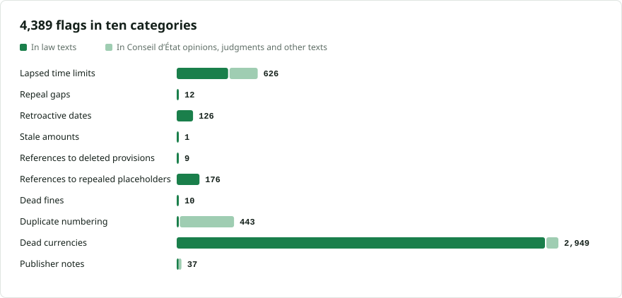

# Vulnerabilities in Luxembourg law

[Français](README.md) · **English**

<picture>
<source media="(prefers-color-scheme: dark)" srcset="img/flags-by-category-dark.svg">

</picture>

The vulnerability detectors from [lexifina/global-law](https://github.com/lexifina/global-law/tree/main/vulnerabilities) look for mechanical mistakes in legislation: a rule applying "until" a date that has passed, a time limit extended only after it had run out, a provision repealed before its replacement took effect, two amendments to the same provision on the same day, a reference to an article that no longer exists. global-law's published list (9 November 2026) covered Luxembourg with 19 flags from an earlier copy of this repository. This is a run over this repository only, as it stood at commit [`926b2bf`](https://github.com/lexifina/luxembourg-law/commit/926b2bff9865b47ca2133e330fbcc88d0a298eff) on 15 November 2026, with the Constitution, the laws in force and the repealed laws its history holds, and the Cour de cassation judgments and Conseil d'État opinions it also holds. It finds the same number of repeal gaps as that list (12), more lapsed time limits (626 against 1), retroactive dates (126 against 1) and references to deleted provisions (9 against 5), and six categories that list did not have for Luxembourg: stale amounts (1), references to repealed placeholders (176), dead fines (10), duplicate numbers (443), dead currencies (2,949) and publisher notes (37).

**In short:** the detectors raised 4,389 flags. A language model reviewed 104 of the strongest, arguing each one for and against; 14 survived. Checked by hand in this repository, none is a mistake in Luxembourg law. The 13 retroactive dates are effects the law itself backdates: the whole law in 6 (for example the law of 4 June 2024 on procedure in social security matters, which "produit ses effets au 8 décembre 2022"), only some of its articles, or its articles from different days, in 7, where this repository still dates the whole law from the first of those days. The repeal gap is an article number used again: the law of 9 January 2021 repealed Article 3ter of the Covid-19 law, which closed cultural establishments, and the law of 12 June 2021 gave the number to recovery certificates. In a category the model does not review, one reference looks like a real mistake: Article 563 of the Code de commerce has the curators note the sum paid "conformément à l'article 480", but the law of 7 August 2023 modernising insolvency law repealed Article 480 without amending Article 563. Later, this will be formalised in Lean, similar to our work on [the US tax code](https://lexifina.com/blog/formalizing-the-us-tax-code) and [US case law](https://lexifina.com/blog/formalizing-all-us-case-law-in-lean).

A flag is a prompt to look, not legal advice, and nothing here has been tested in court.

## Flags by category

| Category | What it looks for | Flags | In law texts | Reviewed | Survived review |
| --- | --- | ---: | ---: | ---: | ---: |
| Lapsed time limits | Text still applying a rule "until" a date that has passed | 626 | 397 | 42 | 0 |
| Repeal gaps | A provision removed before its replacement took effect | 12 | 12 | 12 | 1 |
| Retroactive or pre-publication dates | A rule in force before it was made or published | 126 | 126 | 40 | 13 |
| Stale amounts | An amount changed in one place but still standing elsewhere | 1 | 1 | 1 | 0 |
| References to deleted provisions | A provision citing an article that no longer exists | 9 | 9 | 9 | 0 |
| References to repealed placeholders | A provision citing an article that now reads only "Abrogé" | 176 | 176 | 0 | 0 |
| Dead fines | A penalty for breaching an article that has been repealed | 10 | 10 | 0 | 0 |
| Duplicate numbering | Two units with the same number in one text | 443 | 13 | 0 | 0 |
| Dead currencies | Amounts in currencies no longer in use | 2,949 | 2,845 | 0 | 0 |
| Publisher notes | Notes that an amendment could not be carried out, or a "(sic)" | 37 | 3 | 0 | 0 |

"In law texts" counts the Constitution and the laws in `loi/`, which also holds the codes (Code civil, Code de commerce, Code pénal, Code d'instruction criminelle and the rest). The other flags are in the Conseil d'État opinions and Cour de cassation judgments this repository also holds, which are not law; the one file in `memorial-b/`, a list of insurance-broker approvals published in Mémorial B, is not law either and has no flags. Only the Constitution and the Covid-19 law of 17 July 2020 have every version here; every other law has one text, as published or as currently consolidated, and a second commit removes it when it ceases to be in force. So the history detectors find repeal gaps only in those two texts, no same-day conflicts and no empty periods; the search for retroactive dates compares each law's publication date with the day this repository has it take effect.

*Edge cases: the 14 flags that survived the review, grouped by what they turned out to be, the reference found among the flags the model does not review, and what the other flags are, in [EDGE-CASES.en.md](EDGE-CASES.en.md).*

## Problems found in this repository

- **Laws dated from the day only some of their articles take effect:** a law's text as published is dated by the entry into force Legilux gives, which for a law with some backdated articles is the day those take effect. The [law of 18 June 2020](https://github.com/lexifina/luxembourg-law/blob/926b2bff9865b47ca2133e330fbcc88d0a298eff/loi/2020/06/18/a504/art_7.md) amending the CRS (NCD) and FATCA laws "entre en vigueur le 1er janvier suivant l'année civile au cours de laquelle [elle] a été publiée", that is on 1 January 2021, except for its Article 3; this repository dates it 1 January 2016, so its whole text is in force in the record from 2016. Seven of the surviving flags are of this kind ([Edge cases](EDGE-CASES.en.md)).
- **Four laws whose only text applies from a future date:** for the law of 6 February 2009 organising basic education, the law of 12 November 2002 on private security and guarding, the law of 26 February 2016 creating a public international school in Differdange and the budget law of 19 December 2025 for 2026, this repository holds only Legilux's consolidated version applicable from 15 September 2030, 1 February 2027 or 15 September 2027, in a commit dated that day. The text that applies today is not there, and for any earlier date the record gives these laws no text at all.
- **Line breaks written as `\n`:** 111 commit messages give a law's title with its line breaks as a literal `\n`, for example that of the [budget law of 19 December 2025](https://github.com/lexifina/luxembourg-law/commit/aff4c90cf57283158a2eff63536e947219cc07ca).

## Files

| File | What it holds |
| --- | --- |
| [data/flags.csv](data/flags.csv) | Every flag, one row per provision and issue |
| [data/reviewed.csv](data/reviewed.csv) | The 104 flags the model reviewed, with its verdict and reason |
| [data/by_category.csv](data/by_category.csv) | The counts in the table above |
| [tools/](tools/) | The scripts that made this run |

Columns: `category` and `category_fr` (the category in English and French), `detector`, `kind` (`law` or `other`), `path` (the article in this repository; for a retroactive date, the first file the law wrote that day), `date` (the date the flag turns on), `reference` (the text or line involved), `summary`, `score` (the detector's ranking, 0 to 1), `review` (`artefact`, `lawful` or `candidate_defect`), `survives_rebuttal`, `review_note` (the model's reason, in English), `url` (the article at the commit that was read, or, for an article repealed since, at the last commit that held it; for a retroactive date, the commit that wrote the law's text that day).

## How it was made

- **Detectors:** global-law's [vulnerabilities/scripts](https://github.com/lexifina/global-law/tree/main/vulnerabilities/scripts), with the fixes in [tools/patch_detectors.py](tools/patch_detectors.py) and the other `patch_*.py` scripts, run on this repository at commit `926b2bf`. global-law replays this repository only up to an earlier commit, so the history table the detectors read was built from this repository's own commits (the author, that is the law that made each change, and the `In-force` and `Kind` trailers); 7,909 commits count as law. Two fixes for this repository ([tools/patch_lu.py](tools/patch_lu.py)): the dead-currency search also reads the Luxembourg franc written "fr.", "frs" or "LUF", without which 1,805 of the 2,845 flags in law texts would be missing; and the detectors read file names with accents (`art_12_rubrique_administration_générale.md`) as they are written, which brought references to deleted provisions down from 66 to 9.
- **Model review:** gpt-5.4-mini, the 40 strongest flags per category, which is every flag in the categories that have fewer, and the 40 strongest lapsed time limits in law texts; one pass says whether a flag is real, a second argues that it is not. After the second fix the detectors were run again and the strong flags not yet reviewed went to the model, hence 42 lapsed time limits reviewed; the reviews already made were kept. There were no empty periods to review. The model does not review the last five categories. global-law's own list used a different model.
- **Hand check:** every case that survived was read in this repository's history and texts, with the law's own article on when it takes effect. The dates are Legilux's; the open reference still needs the Mémorial and the text of Article 480 before 2023, which this repository does not hold.

To report a correction, open an issue with the provision and an official source.

## Licence

The lists and notes are Lexifina's, dedicated to the public domain under CC0 1.0, like the rest of this repository's own contributions. Quoted law text comes from Legilux's open data (Ministère d'État, Service central de législation), reused under CC BY 4.0 with the attribution in [LICENSE](../LICENSE); quotations from judgments and opinions are verbatim, under CC BY-ND 4.0 ([TERMS.md](../TERMS.md)).
