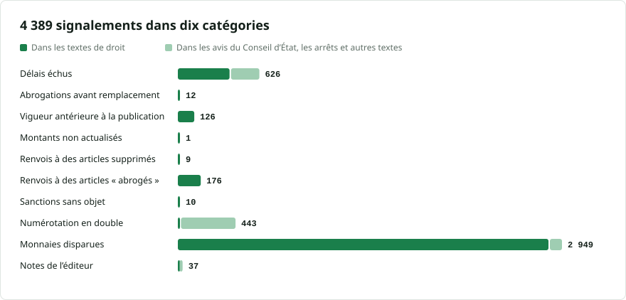

# Vulnérabilités du droit luxembourgeois

**Français** · [English](README.en.md)

<picture>
<source media="(prefers-color-scheme: dark)" srcset="img/flags-by-category-dark.fr.svg">

</picture>

Les détecteurs de vulnérabilités de [lexifina/global-law](https://github.com/lexifina/global-law/tree/main/vulnerabilities) recherchent les erreurs mécaniques de la législation : une règle qui s’applique encore « jusqu’au » une date déjà passée, un délai prorogé seulement après son expiration, une disposition abrogée avant l’entrée en vigueur de celle qui la remplace, deux modifications d’une même disposition le même jour, un renvoi à un article qui n’existe plus. La liste publiée par global-law le 9 novembre 2026 couvrait le Luxembourg avec 19 signalements, tirés d’une copie antérieure de ce dépôt. Il s’agit ici d’une analyse de ce seul dépôt, dans l’état du commit [`926b2bf`](https://github.com/lexifina/luxembourg-law/commit/926b2bff9865b47ca2133e330fbcc88d0a298eff) du 15 novembre 2026, avec la Constitution, les lois en vigueur et les lois abrogées que l’historique contient, ainsi que les arrêts de la Cour de cassation et les avis du Conseil d’État qu’il comprend aussi. Elle trouve autant d’abrogations avant remplacement (12) que cette liste, davantage de délais échus (626 contre 1), de dates de vigueur antérieures à la publication (126 contre 1) et de renvois à des dispositions supprimées (9 contre 5), ainsi que six catégories que cette liste ne comptait pas pour le Luxembourg : les montants non actualisés (1), les renvois à des articles « abrogés » (176), les sanctions sans objet (10), les numéros en double (443), les monnaies disparues (2 949) et les notes de l’éditeur (37).

**En bref :** les détecteurs ont produit 4 389 signalements. Un modèle de langage a examiné les 104 plus forts, en pesant pour chacun les arguments pour et contre ; 14 ont résisté. Vérifiés à la main dans ce dépôt, aucun ne révèle une erreur du droit luxembourgeois. Les 13 dates de vigueur antérieures à la publication sont des effets rétroactifs que la loi prévoit elle-même : pour toute la loi dans 6 cas (par exemple la loi du 4 juin 2024 sur la procédure en matière de sécurité sociale, qui « produit ses effets au 8 décembre 2022 »), pour certains articles seulement, ou à des dates différentes selon les articles, dans 7 cas, où ce dépôt date pourtant toute la loi du premier de ces jours. L’abrogation avant remplacement est un numéro réutilisé : la loi du 9 janvier 2021 a abrogé l’article 3ter de la loi Covid-19, qui fermait les établissements culturels, et la loi du 12 juin 2021 a donné ce numéro aux certificats de rétablissement. Dans une catégorie que le modèle n’examine pas, un renvoi ressemble à une véritable erreur : l’article 563 du Code de commerce fait mentionner par les curateurs la somme payée « conformément à l’article 480 », alors que la loi du 7 août 2023 portant modernisation du droit de la faillite a abrogé l’article 480 sans modifier l’article 563. Ces textes seront ensuite formalisés en Lean, comme nos travaux sur [le code des impôts des États-Unis](https://lexifina.com/blog/formalizing-the-us-tax-code) et [la jurisprudence américaine](https://lexifina.com/blog/formalizing-all-us-case-law-in-lean).

Un signalement invite à regarder de plus près ; ce n’est pas un conseil juridique, et rien de ce qui figure ici n’a été soumis à un juge.

## Signalements par catégorie

| Catégorie | Ce qu’elle recherche | Signalements | Dans les textes de droit | Examinés | Retenus après examen |
| --- | --- | ---: | ---: | ---: | ---: |
| Délais échus | Un texte qui applique encore une règle « jusqu’au » une date passée | 626 | 397 | 42 | 0 |
| Abrogations avant remplacement | Une disposition supprimée avant l’entrée en vigueur de celle qui la remplace | 12 | 12 | 12 | 1 |
| Vigueur antérieure à la publication | Une règle en vigueur avant d’avoir été prise ou publiée | 126 | 126 | 40 | 13 |
| Montants non actualisés | Un montant modifié à un endroit mais maintenu ailleurs | 1 | 1 | 1 | 0 |
| Renvois à des dispositions supprimées | Une disposition qui renvoie à un article qui n’existe plus | 9 | 9 | 9 | 0 |
| Renvois à des articles « abrogés » | Une disposition qui renvoie à un article réduit à la mention « Abrogé » | 176 | 176 | 0 | 0 |
| Sanctions sans objet | Une sanction pour la méconnaissance d’un article abrogé | 10 | 10 | 0 | 0 |
| Numérotation en double | Deux subdivisions portant le même numéro dans un même texte | 443 | 13 | 0 | 0 |
| Monnaies disparues | Des montants exprimés dans une monnaie qui n’a plus cours | 2 949 | 2 845 | 0 | 0 |
| Notes de l’éditeur | Des notes indiquant qu’une modification n’a pu être faite, ou un « (sic) » | 37 | 3 | 0 | 0 |

« Dans les textes de droit » comprend la Constitution et les lois du dossier `loi/`, qui contient aussi les codes (Code civil, Code de commerce, Code pénal, Code d’instruction criminelle et les autres). Les autres signalements portent sur les avis du Conseil d’État et les arrêts de la Cour de cassation que ce dépôt contient également, et qui ne sont pas du droit ; l’unique fichier du dossier `memorial-b/`, une liste d’agréments de courtiers d’assurances publiée au Mémorial B, n’en est pas non plus et ne porte aucun signalement. Seules la Constitution et la loi Covid-19 du 17 juillet 2020 ont ici toutes leurs versions ; les autres lois n’ont qu’un texte, le texte tel que publié ou le texte consolidé actuel, et un second commit les retire lorsqu’elles cessent d’être en vigueur. Les détecteurs fondés sur l’historique ne trouvent donc d’abrogations avant remplacement que dans ces deux textes, aucune modification du même jour et aucune période non couverte ; la recherche des dates de vigueur antérieures compare la date de publication de chaque loi avec le jour d’entrée en vigueur que ce dépôt lui donne.

*Cas limites : les 14 signalements retenus après examen, regroupés selon ce qu’ils se sont révélés être, le renvoi relevé parmi les signalements que le modèle n’examine pas, et la nature des autres signalements, dans [EDGE-CASES.md](EDGE-CASES.md).*

## Problèmes relevés dans ce dépôt

- **Lois datées du jour où certains articles seulement prennent effet :** le texte tel que publié d’une loi est daté du jour d’entrée en vigueur que donne Legilux, qui est, pour une loi dont certains articles rétroagissent, le jour où ceux-ci prennent effet. La [loi du 18 juin 2020](https://github.com/lexifina/luxembourg-law/blob/926b2bff9865b47ca2133e330fbcc88d0a298eff/loi/2020/06/18/a504/art_7.md) modifiant les lois NCD et FATCA « entre en vigueur le 1er janvier suivant l’année civile au cours de laquelle [elle] a été publiée », soit le 1er janvier 2021, à l’exception de son article 3 ; ce dépôt la date du 1er janvier 2016, de sorte que tout son texte est en vigueur dans le registre dès 2016. Sept des signalements retenus sont de ce type ([cas limites](EDGE-CASES.md)).
- **Quatre lois dont le seul texte s’applique à une date future :** pour la loi du 6 février 2009 portant organisation de l’enseignement fondamental, la loi du 12 novembre 2002 relative aux activités privées de gardiennage et de surveillance, la loi du 26 février 2016 portant création d’une école internationale publique à Differdange et la loi budgétaire du 19 décembre 2025 pour l’exercice 2026, ce dépôt ne contient que la version consolidée de Legilux applicable à partir du 15 septembre 2030, du 1er février 2027 ou du 15 septembre 2027, dans un commit daté de ce jour. Le texte qui s’applique aujourd’hui n’y figure pas, et à toute date antérieure le registre ne donne aucun texte pour ces lois.
- **Retours à la ligne écrits `\n` :** 111 messages de commit reproduisent l’intitulé d’une loi avec des retours à la ligne sous la forme littérale `\n`, par exemple celui de la [loi budgétaire du 19 décembre 2025](https://github.com/lexifina/luxembourg-law/commit/aff4c90cf57283158a2eff63536e947219cc07ca).

## Fichiers

| Fichier | Contenu |
| --- | --- |
| [data/flags.csv](data/flags.csv) | Tous les signalements, une ligne par disposition et par problème |
| [data/reviewed.csv](data/reviewed.csv) | Les 104 signalements examinés par le modèle, avec son avis et sa motivation |
| [data/by_category.csv](data/by_category.csv) | Les chiffres du tableau ci-dessus |
| [tools/](tools/) | Les scripts qui ont produit cette analyse |

Colonnes : `category` et `category_fr` (la catégorie en anglais et en français), `detector`, `kind` (`law` ou `other`), `path` (l’article dans ce dépôt ; pour une date de vigueur antérieure, le premier fichier écrit ce jour-là par la loi), `date` (la date sur laquelle porte le signalement), `reference` (le texte ou la ligne en cause), `summary`, `score` (le classement du détecteur, de 0 à 1), `review` (`artefact`, `lawful` ou `candidate_defect`), `survives_rebuttal`, `review_note` (la motivation du modèle, en anglais), `url` (l’article dans le commit examiné ou, pour un article abrogé depuis, dans le dernier commit qui le contenait ; pour une date de vigueur antérieure, le commit qui a écrit le texte de la loi ce jour-là).

## Méthode

- **Détecteurs :** les [vulnerabilities/scripts](https://github.com/lexifina/global-law/tree/main/vulnerabilities/scripts) de global-law, avec les corrections de [tools/patch_detectors.py](tools/patch_detectors.py) et des autres scripts `patch_*.py`, exécutés sur ce dépôt au commit `926b2bf`. global-law ne rejoue ce dépôt que jusqu’à un commit antérieur ; la table d’historique lue par les détecteurs a donc été construite à partir des commits de ce dépôt (l’auteur, c’est-à-dire la loi auteur de chaque modification, et les trailers `In-force` et `Kind`) ; 7 909 commits comptent comme du droit. Deux corrections propres à ce dépôt ([tools/patch_lu.py](tools/patch_lu.py)) : la recherche des monnaies disparues lit aussi le franc luxembourgeois écrit « fr. », « frs » ou « LUF », sans quoi 1 805 des 2 845 signalements dans les textes de droit manqueraient ; et les détecteurs lisent les noms de fichiers accentués (`art_12_rubrique_administration_générale.md`) tels qu’ils sont écrits, ce qui a ramené les renvois à des dispositions supprimées de 66 à 9.
- **Examen par le modèle :** gpt-5.4-mini, sur les 40 signalements les plus forts de chaque catégorie, soit tous ceux des catégories qui en comptent moins, et les 40 délais échus les plus forts dans les textes de droit ; un premier passage dit si le signalement est fondé, un second plaide le contraire. Après la seconde correction, les détecteurs ont été relancés et les signalements forts non encore examinés ont été soumis au modèle, d’où 42 délais échus examinés ; les avis déjà rendus ont été conservés. Il n’y avait aucune période non couverte à examiner. Le modèle n’examine pas les cinq dernières catégories. La liste de global-law a été établie avec un autre modèle.
- **Vérification manuelle :** chaque cas retenu a été lu dans l’historique et les textes de ce dépôt, avec l’article de la loi qui fixe sa prise d’effet. Les dates sont celles de Legilux ; le renvoi ouvert demande encore le Mémorial et le texte de l’article 480 avant 2023, que ce dépôt ne contient pas.

Pour signaler une correction, ouvrez une issue indiquant la disposition et une source officielle.

## Licence

Les listes et les notes appartiennent à Lexifina et sont placées dans le domaine public sous CC0 1.0, comme les autres contributions propres de ce dépôt. Le texte des lois cité provient des données ouvertes de Legilux (Ministère d’État, Service central de législation), réutilisées sous licence CC BY 4.0 avec l’attribution que donne [LICENSE](../LICENSE) ; les extraits d’arrêts et d’avis sont reproduits à l’identique sous CC BY-ND 4.0 ([TERMS.md](../TERMS.md)).
